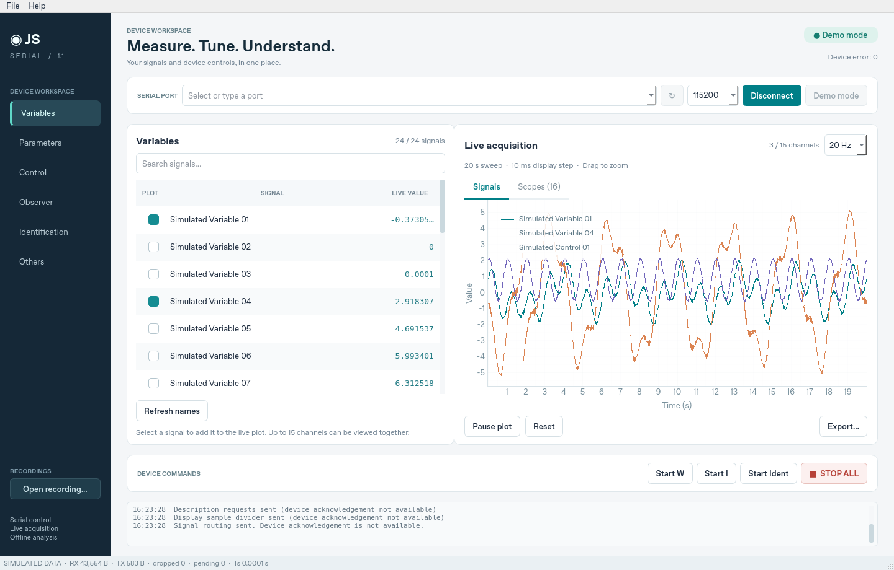

# GUI UART — Python desktop application

A Python replacement for the supplied MATLAB GUIDE UART interface, built with Qt. It keeps the original device commands, editable control groups, live plots, and recording workflow in one desktop window. The 19 original MATLAB files are preserved in [`legacy/matlab`](legacy/matlab).



## Run

### Windows: double-click launcher

Extract the project ZIP, then double-click **`run.bat`** in the `GUI_UART-main`
folder. Install Python 3.10 or newer first if it is not already installed.
The launcher creates a local `.venv`, installs missing application dependencies
on the first run, and starts the app. Internet access is needed to install
packages. Subsequent launches reuse the environment. Any errors stay visible
in the terminal window.

To start with simulated data, run this from Command Prompt in the project folder:

```bat
run.bat --demo
```

### Manual installation

Use Python 3.10 or newer:

```bash
python -m venv .venv
```

Activate the environment:

```bash
# Linux / macOS
source .venv/bin/activate

# Windows PowerShell
.venv\Scripts\Activate.ps1
```

Install and launch from the project directory:

```bash
python -m pip install -e '.[dev]'
python -m uart_gui
```

`python main.py` is an alternative launcher. To explore without a serial device:

```bash
python -m uart_gui --demo
```

Demo mode generates simulated data; it does not establish that a physical device works.

## Use

1. Refresh the port list, choose the device and baud rate, then connect. The original default is **115200 baud, 8 data bits, no parity, 1 stop bit (8N1)**.
2. Click **Refresh names** to replace fallback field names with descriptions supplied by the firmware.
3. Use **Variables**, **Parameters**, **Control**, **Observer**, **Identification**, and **Others** to inspect current values. Editable groups support individual writes and **Write all**. A group write uses your edits or received live values, validates the entire batch first, then sends it with the original pacing. **Use live** fills editors from current device values. Invalid numeric input is rejected before transmission.
4. Select up to **15 signals** for live plotting; you can prepare this selection while disconnected. Start W, Start I, Start Ident, and STOP retain their original device command addresses.
5. Export acquired data as MAT or CSV. Use **File → Export scopes** for a scope-only MAT file. **Open recording…** opens the offline viewer; use its **Open** button to choose a recording, then apply moving-average smoothing if desired. Reset clears local plot/recording data.

Connecting and loading descriptions do not start the device’s W, I, or identification routines. These controls send the same commands as the MATLAB interface; their physical meaning depends on the connected firmware.

Use the app on the computer that can access the serial port. A USB device connected to your laptop is not automatically available inside a cloud environment. On Linux, serial access may require membership in `dialout` (or the distribution’s serial-device group); sign out and back in after changing group membership. Windows uses COM ports, and macOS typically exposes `/dev/cu.*` devices.

## Validate

```bash
python -m pytest
```

For GUI checks on a Linux machine without a display:

```bash
QT_QPA_PLATFORM=offscreen python -m pytest
```

Tests exercise the Python implementation using synthetic data and simulated serial I/O. Hardware compatibility still requires a connected device: no firmware source, device capture, or physical UART hardware was supplied. The packet format was recovered from the MATLAB source; see [`docs/MIGRATION.md`](docs/MIGRATION.md) for the compatibility map and protocol details.

The conversion passed **45 automated tests**, including Qt interactions and a pyserial pseudoterminal integration test. See [`docs/VALIDATION.md`](docs/VALIDATION.md) for the tested environment.
